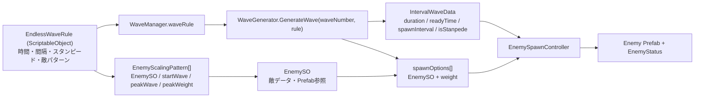
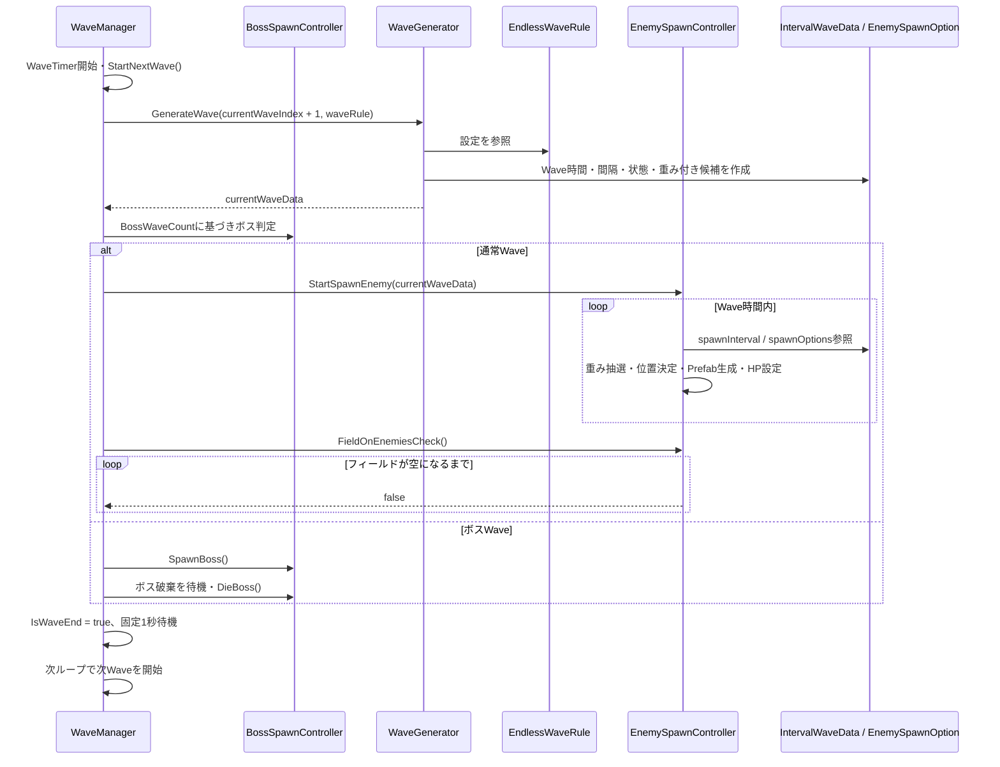
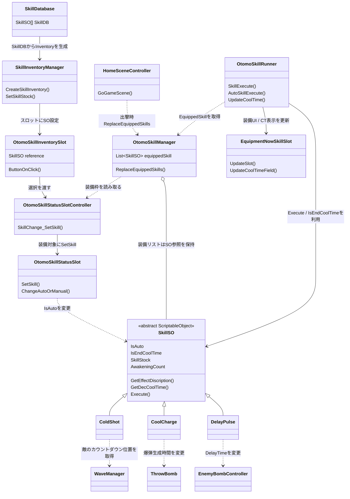

# Bomb Crash — Wave生成・オトモスキル調査

## 調査の基準と範囲

- 対象リポジトリ: [HinataPiyo/BombCrash](https://github.com/HinataPiyo/BombCrash)
- ソース基準: `e4fc3fe45371a4f4b6e214522991a8e64b4e50a5`
- 調査対象: リポジトリ直下のREADME、`Assets/Docs/README.md`（ゲーム説明書）、`Assets/Docs/documentation.md`（開発・設計ドキュメント）、Wave / SO / オトモスキル / スキルUI / ガチャ関連C#、対象シンボルの参照検索。プロジェクト内Editor拡張も検索した。
- 全アセットの個別監査ではない。Unity Editorでの起動、Play Mode、ビルド、自動テストは未実施。以下は固定コミットのソースと資料を静的に照合した結果で、本人の設計意図や担当を証明するものではない。

### 資料とコードの整合

- READMEとゲーム説明書は、敵のカウントダウン、爆弾の所持上限と時間補充、敵撃破時のスクラップ、Wave終了後に敵がいなくなるまで次Waveへ進まないこと、スタンピードやボス、スキルの手動・自動発動を説明している。WaveManager / EnemySpawnControllerのコードと概ね一致する。
- READMEと開発・設計ドキュメントは、`EndlessWaveRule` → `WaveGenerator` → `WaveManager` → `EnemySpawnController`という構成、ScriptableObjectによる設定管理を説明している。設定・データ生成・進行・通常敵出現の責務分担はコードで確認できる一方、「Waveごとの個別データを固定で列挙しない」等の設計理由は資料による説明であり、作者本人の意図確認ではない。
- README / 開発資料はガチャUIを未実装箇所があるため無効化と説明している。ソースには`SkillGacha.SinglePullOnClick` / `MultiPullOnClick`や`SetSkillStock`が残るが、現在のゲームから利用できる完全な取得経路とは扱わない。
- 資料ではWaveの待機時間を設定できるように読めるが、`WaveGenerator`が`readyTime`に値を入れた後、`WaveManager`は`currentWaveData.readyTime`を参照せずWave後に固定1秒待つ。データと進行の実装が一致していない。
- `Assets/ScriptableObject/EndlessWaveRule.asset`はGit LFSポインターとして取得され、設定値をYAMLから確認できなかった。Inspector画像は確認したが、画像の値とリポジトリ内アセットの同一性は断定しない。
- 関連するC#でWave / Skill専用のCustomEditorは見つからなかった。`Assets/OtherAssets/AnimationValidator/Editor`には別用途のEditorツールがある。

## Wave生成システム

### ファイル・クラスと責務

| ファイル / クラス | 主なデータ・メソッド | 呼出元・受渡し先 | 実装上の責務 |
|---|---|---|---|
| `Assets/Scripts/SO/EndlessWaveRule.cs` — `EndlessWaveRule`, `EnemyScalingPattern` | 通常Waveとスタンピードの時間・出現間隔、間隔減少係数、敵HP上昇率、敵パターン配列。各パターンは`EnemySO`、`startWave`、`peakWave`、`peakWeight`を保持 | `WaveManager.waveRule`から`WaveGenerator.GenerateWave`へ渡される | Waveルールの設定データを保持。敵候補の重みの計算自体は行わない |
| `Assets/Scripts/System/Wave/WaveGenerator.cs` — `WaveGenerator` | `GenerateWave(int waveNumber, EndlessWaveRule rule)` | `WaveManager.WaveTimer`から呼ばれ、`IntervalWaveData`を返す | `ScriptableObject.CreateInstance`で実行時データを作成。Wave番号で通常 / スタンピードを判定し、Wave時間・間隔・状態と敵候補の重みを設定 |
| `Assets/Scripts/SO/IntervalWaveData.cs` — `IntervalWaveData` | `waveDuration`, `readyTime`, `spawnInterval`, `isStanpede`, `spawnOptions` | `WaveGenerator`が生成し、`WaveManager`が保持、通常Waveでは`EnemySpawnController.StartSpawnEnemy`に渡す | 1回分のWaveの出現条件と、`EnemySO`・重みを持つ候補配列を運ぶ |
| `Assets/Scripts/System/Wave/WaveManager.cs` — `WaveManager` | `WaveTimer`, `StartNextWave`, `currentWaveIndex`, `waveRule`, UI・ボス・スタンピード参照 | Scene上のMonoBehaviourとして開始。`WaveGenerator`と`EnemySpawnController`を呼び出す | Wave番号更新、データ生成、ボス判定、タイマー/UI、カットイン、終了条件、次Wave移行をまとめて管理 |
| `Assets/Scripts/System/Wave/EnemySpawnController.cs` — `EnemySpawnController` | `StartSpawnEnemy`, `SpawnEnemiesCoroutine`, `ChooseEnemy`, `FieldOnEnemiesCheck`, `EnemyList` | `WaveManager`からWaveデータを受け取る。敵Prefab / `EnemyStatus`を生成・更新し、敵一覧をWaveManagerに返す | Wave時間内に一定間隔で敵を生成し、候補の重みで種類を選択、ランダム位置に配置。HP上昇も適用し、破棄済み敵を一覧から除く |
| 関連: `BossSpawnController` | `BossWaveCount`, `SpawnBoss`, `IsBossSpawned`, `DieBoss`（WaveManagerから利用） | `WaveManager.WaveTimer` | 所定Waveでボスを生成する経路。通常敵の`EnemySpawnController`経路とは分かれる |

### 設定から敵出現まで

1. `EndlessWaveRule`アセットに通常Wave / スタンピード設定と`EnemyScalingPattern[]`を定義する。各パターンは`EnemySO`を参照し、登場開始Wave・ピークWave・最大比重を持つ。
2. `WaveManager.WaveTimer`が`StartNextWave()`で`currentWaveIndex`を増やし、表示を更新した後、`WaveGenerator.GenerateWave(currentWaveIndex + 1, waveRule)`を呼ぶ。
3. `WaveGenerator`は`waveNumber`を使い、`(waveNumber - 1) % stampedeWaveInterval == 0`でスタンピードを判定する。通常Waveの出現間隔は基準間隔からWaveごとの減少量を引き、最小0.3秒に制限。スタンピードでは最小0.1秒と`stampedeSpawnInterval`を比較して短い側を使う。
4. 各敵パターンについて、開始Waveより前なら除外する。それ以外は`Mathf.InverseLerp(startWave, peakWave, waveNumber)`と`Mathf.Lerp(0, peakWeight, Clamp01(t))`から重みを計算し、重みが正なら`IntervalWaveData.spawnOptions`へ追加する。
5. `IntervalWaveData`はWave時間、待機時間、出現間隔、スタンピード状態、候補配列を持つ。ここで出現総数を確定してはいない。
6. ボスWaveでなければ`WaveManager`が`EnemySpawnController.StartSpawnEnemy(currentWaveData)`を呼ぶ。スポーン側コルーチンはWave時間の範囲内で即時に敵を生成し、出現間隔ごとに繰り返す。
7. `ChooseEnemy`は候補weightの合計から乱数を取り、累積weightで`EnemySO.Enemy_Prefab`を選ぶ。`EnemySpawnController`はX/Yの設定範囲内に配置し、`EnemyStatus`の表示順、最大HPリセット、Waveに応じたHP上昇を適用して一覧へ登録する。
8. `WaveManager`は通常Waveの時間経過後、`FieldOnEnemiesCheck()`がtrue（破棄済み要素が除かれた敵一覧が空）になるまで待つ。ボス経路ではボス撃破を待ってから同様の敵一覧チェックを通る。
9. `IsWaveEnd`をtrueにし、現状は固定1秒待ってからループ先頭で次のWaveを開始する。

#### A. データの流れ

#### B. クラス間の処理フロー

### 設計上の特徴と評価

#### A. 現在の実装で機能している点

- **設定と計算の置き場所が分かれている。** `EndlessWaveRule`は調整値、`WaveGenerator`は一回分の`IntervalWaveData`生成を担当し、`EnemySpawnController`は実際のPrefab生成を担当する。
- **候補の重みは敵パターンのデータから組み立てられる。** 現行の敵パターン範囲内なら、`EnemyScalingPattern`の開始 / ピーク / 最大weightと`EnemySO`参照で出現候補を定義できる。
- **通常敵の生成とWave進行の間にデータオブジェクトがある。** `IntervalWaveData`が出現条件を運ぶため、生成条件と敵Prefabの配置処理は異なるクラスにある。

これらは実装構造から読み取れる性質であり、作者が何を意図してその設計を選んだかの本人確認ではない。

#### B. 現在の制約・確認が必要な点

- `WaveManager`はWave開始、ボス / 通常Wave分岐、UI、カットイン、スポーン開始、終了待ちを一つのコルーチンで管理し、`BossSpawnController`や`EnemySpawnController`等の具体クラスとScene UIに依存する。
- `EndlessWaveRule.stampedeWaveInterval`が0の場合の剰余、候補ゼロの`ChooseEnemy`が`options[0]`へ到達する場合を防ぐ入力検証は、対象コードでは確認できない。実際に発生したとは断定しない。
- `IntervalWaveData.readyTime`は生成されるが、WaveManagerは利用せず固定1秒を待つ。設定値を変更してもこの経路の待機時間へ反映されない構造。
- WaveManagerは画面表示用に`currentWaveIndex`を表示する一方、生成器には`currentWaveIndex + 1`を渡す。開始直後の表示値と生成に使う番号が1違う。これが意図的か、敵出現やボス周期に望む結果かは資料だけでは確定できない。
- `EnemySpawnController.FieldOnEnemiesCheck()`は敵一覧の空判定で、Wave終了フラグの判断自体はWaveManagerにある。2つの条件（時間切れと敵全滅）の組み合わせを実行で確認していない。
- `EndlessWaveRule.asset`はGit LFS pointerしか取得できず、実アセット値とのコード・スクリーンショット一致を確認できなかった。

#### 拡張するときに変わる場所

- **既存ルール内で敵を追加:** `EnemySO`とPrefabを用意し、`EndlessWaveRule.enemyPatterns`に開始 / ピーク / weightを設定する。敵に固有のスポーン挙動やWave全体の別ルールを追加する場合は、`WaveGenerator`、`IntervalWaveData`、`EnemySpawnController`や`WaveManager`の分岐変更が必要になる可能性がある。
- **Wave種別を追加:** 現行のWave区分は`isStanpede`というboolと、`WaveManager`の通常 / ボス分岐で表現されている。別種別を単なる数値変更で加えられる構造とは確認できない。データ表現と進行分岐の変更範囲を確認すべき。
- **調整値の変更:** ScriptableObject側の設定で扱える範囲はEditorデータ変更で済む。一方、現状未使用の`readyTime`など、進行クラス側に固定処理がある項目は値変更だけでは挙動が変わらない。

## オトモスキルシステム

### ファイル・クラスと責務

| ファイル / クラス | 主なデータ・メソッド | 呼出元・受渡し先 | 実装上の責務 |
|---|---|---|---|
| `Assets/Scripts/SO/SkillSO.cs` — `SkillSO` | 基本表示データ、`IsAuto`、`IsEndCoolTime`、stock、awakening、`GetDecCoolTime`、`GetEffectDiscription`、抽象`Execute` | Inventory / equipment / runnerが同じ派生SO参照を受け渡す | ScriptableObjectの共通基底。表示・発動設定・進行値に加え、実行状態も保持している。`IsEndCoolTime`の裏フィールドは`[SerializeField]`なしの実行時bool |
| `Assets/Scripts/SO/SkillDatabase.cs` — `SkillDatabase` | `SkillSO[] SkillDB` | `SkillInventoryManager`、`SkillGacha` | スキルSOアセットの一覧を保持 |
| `Assets/Scripts/System/Otomo_Skill/SkillInventoryManager.cs` — `SkillInventoryManager` | `CreateSkillInventory`, `SetSkillStock`, `InventorySlotUpdateUI` | `SkillDatabase`からUIスロットを生成。ガチャコードからStock追加 | 一覧UI生成とstock更新 / 表示更新を担当。取得・所持データの変更処理も部分的に担う |
| `Assets/Scripts/UI/Otomo/OtomoSkillInventorySlot.cs` — `OtomoSkillInventorySlot` | SO参照、stock表示、クリック処理 | 選択中なら`OtomoSkillStatusSlotController.SkillChange_SetSkill`へ。通常は詳細パネルへ | インベントリスロットUI。スキル選択とUI表示をつなぐ |
| `Assets/Scripts/UI/Otomo/OtomoSkillStatusSlotController.cs` — `OtomoSkillStatusSlotController` | 装備枠配列、選択枠、`SkillChange_SetSkill` | `OtomoSkillManager.ReplaceEquippedSkills`から装備枠を参照 | 解放済み枠の選択 / 入替えを管理。同じ`SkillSO`の重複装備は拒否 |
| `Assets/Scripts/UI/Otomo/OtomoSkillStatusSlot.cs` — `OtomoSkillStatusSlot` | SlotState、表示、`SetSkill`, `ChangeAutoOrManual` | Controllerから設定され、クリック・自動/手動ボタン操作を受ける | 装備中スロットの表示と発動モード変更。モード変更はSOの`IsAuto`を書き換える |
| `Assets/Scripts/System/Otomo_Skill/OtomoSkillManager.cs` — `OtomoSkillManager` | `equippedSkill`, `ReplaceEquippedSkills`, Singleton | `HomeSceneController.GoGameScene`が出撃時に呼び、装備枠からリストを作成 | シーンをまたぐ装備中SO参照リストを保持。スキル効果の実行はしない |
| `Assets/Scripts/System/Otomo_Skill/OtomoSkillRunner.cs` — `OtomoSkillRunner` | `Update`, `SkillExecute`, `AutoSkillExecute`, `UpdateCoolTime` | UnityのUpdate / 入力から起動。`OtomoSkillManager.EquippedSkill`を受け取り、`SkillSO.Execute()`を呼ぶ | 戦闘UIへの装備反映、手動 / 自動発動条件、クールタイムと表示更新を一か所で処理 |
| `Assets/Scripts/UI/GameScene/EquipmentNowSkillSlot.cs` — `EquipmentNowSkillSlot` | `UpdateSlot`, `UpdateCoolTimeField`, `EndCoolTime` | Runnerから呼ばれる | 戦闘中アイコン・クールタイムUI表示 |
| `Assets/Scripts/System/Gacha/SkillGacha.cs` / `GachaSystemController.cs` | `Draw`, `RandomSelectSkillSO`, `SinglePullOnClick`, `MultiPullOnClick`, `ApplyGachaCost` | ガチャUIから呼ばれる想定。結果は`SkillInventoryManager.SetSkillStock`へ | ガチャ抽選・コスト・stock追加のコードはあるが、資料では現行ホームボタン無効。利用可能な完成機能として扱わない |
| `Assets/Scripts/System/SkillLogic/{Attack,Auxiliary,Disruption}` — `ColdShot`, `CoolCharge`, `DelayPulse` | `SkillSO`派生、各`Execute`, 効果設定・Prefab参照 | Runnerが派生SOの`Execute`を呼ぶ | スキルごとの具体的な効果実行。`GameSystem`、`WaveManager`、`ThrowBomb`、敵コンポーネント等を直接参照する |

### 取得・装備・発動のデータと呼び出し

1. `SkillDatabase`アセットがスキルSOの配列を持ち、`SkillInventoryManager.CreateSkillInventory`が各SO参照をインベントリUIに設定する。
2. ガチャコードの経路では`SkillGacha`がレアリティを抽選し、対応する`SkillSO`を選び、`SkillInventoryManager.SetSkillStock`が`CountUpStock`を呼ぶ。ただしREADMEはガチャボタン無効を説明する。実UIでの利用は確認できず、公開ページでは取得できる機能として案内しない。
3. `OtomoSkillInventorySlot`からスキルを選択すると`OtomoSkillStatusSlotController.SkillChange_SetSkill`に渡される。Controllerはロック状態・重複を確認して装備枠へ設定し、`OtomoSkillStatusSlot`が名前・効果・覚醒・CTを表示する。自動 / 手動切替は`SkillSO.IsAuto`を書き換える。
4. `HomeSceneController.GoGameScene`はシーン遷移前に`OtomoSkillManager.ReplaceEquippedSkills()`を呼ぶ。Managerは装備枠の配列を走査し、その`SkillSO`参照を`equippedSkill`へ格納する。
5. 戦闘側`OtomoSkillRunner.Start`は`OtomoSkillManager.EquippedSkill`のリスト参照をそのまま受け取り、`EquipmentNowSkillSlot`へアイコンを反映し、装備SOの`IsEndCoolTime`をtrueにする。
6. `Update`は装備ごとに`IsAuto`かつ`IsEndCoolTime`を確認し、`EnemyList.Count > 0`の場合に自動発動コルーチンを開始する。手動発動はZ / X / Cからslot index 0 / 1 / 2の`SkillExecute`を呼ぶ。
7. `SkillExecute`は空リスト・空SO・クールタイム中かを確認し、`SkillSO.Execute()`を呼ぶ。発動後、`UpdateCoolTime`が`IsEndCoolTime=false`にしてSOの`CoolTime`に応じてUIを更新、終了時にtrueへ戻す。
8. 派生SOが効果を適用する。例: `ColdShot.Execute`はコルーチンを開始し、`WaveManager.GetCrossTo0Enemy()`でカウントダウンが最小の敵位置を取り、Prefabをオトモ位置に生成して目標位置を設定する。`CoolCharge`は`ThrowBomb.CreateBombTimeUp`、`DelayPulse`は敵の`EnemyBombController.DelayTime`等を直接更新する。

### オトモスキルのクラス図

### 設計上の特徴と評価

#### A. 現在の実装で機能している点

- **スキル参照を共通型で受け渡す。** Inventory、装備枠、Manager、Runnerが`SkillSO`参照を利用し、実行時に型ごとに`Execute`を呼ぶ。`ColdShot`、`CoolCharge`、`DelayPulse`は派生クラスで効果を実装する。
- **装備一覧の更新と戦闘時発動は別コンポーネントにある。** `OtomoSkillManager`は出撃前に装備リストを作り、`OtomoSkillRunner`は戦闘時の入力・自動条件・CTを扱う。
- **手動と自動が同じ実行経路に合流する。** 入力・自動待機の双方が`SkillExecute`を経由し、発動可能状態をそこで確認する。

これはコード構造の説明であり、本人がこれらを意図した設計判断として行ったかは未確認。

#### B. 現在の制約・確認が必要な点

- `SkillSO`は表示・スキル設定・stock / awakeningに加えて`IsAuto`、`IsEndCoolTime`という変更可能な状態を持つ。`IsEndCoolTime`の裏フィールドはシリアライズされない実行時boolだが、Inventory / Equipment / Runnerは同一SOアセット参照を共有するため、同じインスタンスを使う場所ではプレイ中状態も共有される。
- `OtomoSkillStatusSlot`の自動 / 手動切替はSOアセットの`IsAuto`を直接変更する。Runnerも`IsEndCoolTime`をSO上で更新するため、装備データとランタイム状態がアセット参照を介して一体化している。
- `OtomoSkillRunner`は発動条件・入力割当・効果呼出し・クールタイム・画面表示更新を担う。条件が増えると責務が集中する。
- 手動入力の`SkillExecute(index)`は`equippedSkill.Count == 0`は見るが、`index < Count`は確認しない。空き枠やスロット数とリスト数の組み合わせによって範囲外参照になる可能性がある。
- `Update`は自動発動可能条件がtrueの間、1秒待機コルーチンを開始し続ける。複数コルーチンの発生を抑止するフラグは確認できない。クールタイム開始後に残りは発動条件を再確認するが、コルーチン生成自体の重複はある。
- `SkillSO.Execute`や派生クラスは`GameSystem.Instance`、`WaveManager.Instance`、Player / enemyコンポーネントへ直接アクセスする。効果の単体テストや他対象での再利用には具体依存が関係する。
- `SkillDatabase`はスキル型の一覧、`SkillInventoryManager`はインベントリUIとstock更新、`OtomoSkillManager`は装備SO参照、`OtomoSkillRunner`は発動状態を持つ。stock・awakening・発動設定・CT状態が複数の役割にまたがり、ランタイム状態の所有先は一つにまとまっていない。
- 抽象`SkillSO`で効果を派生クラスに分けているが、汎用効果データと実行方法を別オブジェクトに分離した構造ではない。スキルごとの設定はPrefab参照・コード内配列などにまたがる。
- 固定3キーの入力がRunnerに直書きされる。スキル枠を増やす場合はコード、戦闘UI、装備枠構成を合わせて変更する必要がある。
- ガチャ処理コードは存在するが、READMEはホーム画面ボタンを無効としている。UIからStockが正しく取得・保存される一連の動作は確認していない。

#### 取得・装備・効果追加時に変わる場所

- **手元の既存スキルSOを装備:** インベントリUIで枠選択を開始し、`OtomoSkillInventorySlot`から`OtomoSkillStatusSlotController`へ同じSO参照が渡る。枠のロック・重複確認・モード切替はUI側の各クラスが担う。
- **スキルを増やす:** 現状のパターンでは`SkillSO`派生クラスに`Execute` / 説明 / CT計算を実装し、必要ならPrefab参照・効果側コンポーネントを用意し、ScriptableObjectと`SkillDatabase`に登録する。新しいキーや枠数まで増やす場合は`OtomoSkillRunner`の固定入力とUI構成も変更対象になる。
- **取得・成長:** ガチャは`SkillGacha`と`SkillInventoryManager.SetSkillStock`の経路、覚醒は`UpgradeButton`と`SkillSO.CountUpAwakening`の経路がある。ただしガチャは未使用 / 無効化と資料にあり、動作可能な取得機能とは案内しない。

## 総合評価と改善優先度

| 観点 | Wave | オトモスキル |
|---|---|---|
| 責務分離 | 設定・生成・スポーンは分かれるが、WaveManagerに進行・UI・ボス連携が集まる | 装備リスト更新と発動処理は別だが、RunnerとSkillSOへ複数責務・実行状態が集中 |
| データ設計 | ルールと1Wave分データをScriptableObjectで表現。`readyTime`等の未接続データがある | SkillSO共通型と派生効果SOがあるが、設定データと可変のランタイム状態が同居 |
| 依存関係 | WaveManagerからSpawn/Boss/UIへ具体参照が多い | Singletonと具象ゲームシステムへの直接参照が複数 |
| 拡張性 | 既存敵パターン追加はデータ経由で可能。新しいWave種別はデータ追加だけで済まない | 派生SOで効果を追加可能。固定3キー・slot構成・共有SO状態が拡張制約 |
| 保守性 | 番号ずれ、未使用待機時間、境界条件を明示的にテストする必要 | SO上の可変状態、発動コルーチン、index境界を明確にする必要 |
| 可読性 | 主要4クラスを追えば大枠は把握できるが、責務とデータ実値を実行で確認する余地 | 取得 / 装備 / 発動 / 効果がUI・Manager・Runner・派生SOにまたがる |

### 今後の改善候補

1. **Wave番号・タイミングの仕様を統一しテストする。** 表示Wave番号と生成Wave番号の関係を決め、`currentWaveIndex + 1`と敵HP計算・ボス周期も含めて確認。`readyTime`を実際に使うか削除 / 意図を整理する。
2. **Wave入力の境界条件を検査する。** 0以下のスタンピード間隔、敵候補なし、null EnemySO / Prefab、`peakWave <= startWave`をアセット検証または生成時検証で扱う。Wave終了条件をテスト可能な単位にする。
3. **WaveManagerの進行責務を段階的に分ける。** 波種判定・タイマー / UI・スポーン・終了待ちのうち、実際に変更頻度の高いものから分離する。仕様規模に対し大きなフレームワークは導入しない。
4. **SkillSO設定と実行状態を分ける。** `IsAuto`、クールタイム残量 / 終了状態、stock / awakeningの所有単位を整理し、共有SOアセットの可変値がシーンや装備にどう影響するかをテストする。
5. **スキルRunnerを安全にする。** キーとスロットの範囲検証、AutoSkillExecute重複起動防止、CTをスキル個別状態として管理する。発動判断とUI更新の分離は、必要になった範囲だけ行う。
6. **取得フローを再有効化する前に縦断確認する。** 抽選・IP消費・stock反映・UI・保存 / 読込の一連を確認し、未実装と説明される状態とコードの利用可能範囲を一致させる。

## ポートフォリオへ反映した内容

- Wave技術解説を、ルール設定 → WaveGeneratorのデータ計算 → WaveManagerの進行 → EnemySpawnControllerのweighted choice / 位置生成 / HP設定の順にした。コードリンクは固定コミットにそろえた。
- オトモスキル解説は、装備スロットから出撃時リストへの反映 → Runnerによる手動 / 自動条件とCT → SkillSO派生型の効果実行の順とし、スキル追加時に編集する場所と現状の固定3キーを明記した。
- Wave設定画像とSkillSO Inspector画像は既存ファイルを利用。後者は`DelayPulse`のInspector設定例で、装備画面・実行中画面とは説明しない。
- スクラップ / IPの概要説明重複を整理。ゲーム進行はプレイヤー視点、技術解説は内部のクラスとデータの流れに分離した。

### 画像・動作の未確認

- ローカルサイトには`BombCrash_EndlessWaveGeneration.png`（Wave設定Inspector）と`BombCrash_Skill_Data.png`（DelayPulse SOの設定Inspector）がある。2枚目には発動モード、カテゴリ、名前、レアリティ、CT、stock / awakening、Prefab参照が見える。
- 今回確認したローカル画像一覧にはスキル装備画面や、ゲーム中のスキル発動画面は見当たらない。実在素材が後で用意できた場合は、どの処理の結果かを対応づけて追加する。
- YouTube紹介動画の内容 / 対象ビルド / 再生、Inspector画像と固定コミット内アセットの一致、Unity Editor上の処理実行、チーム内で本人が担った各クラス・機能の範囲は未確認。
